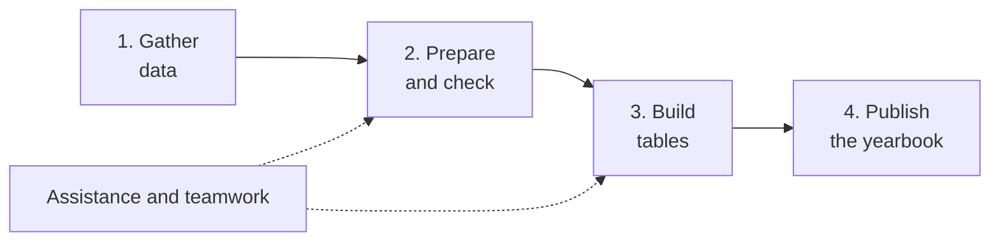
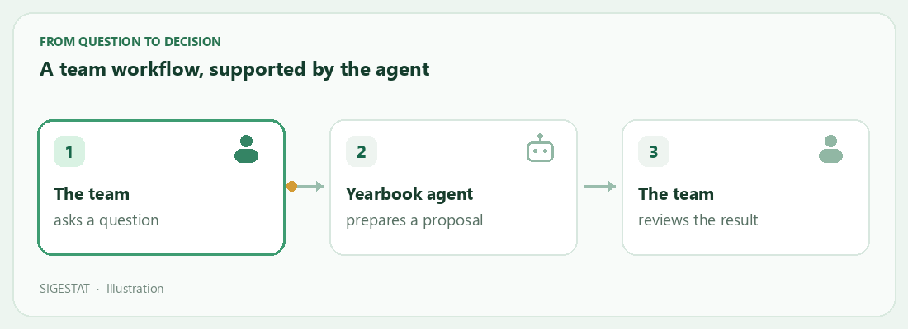
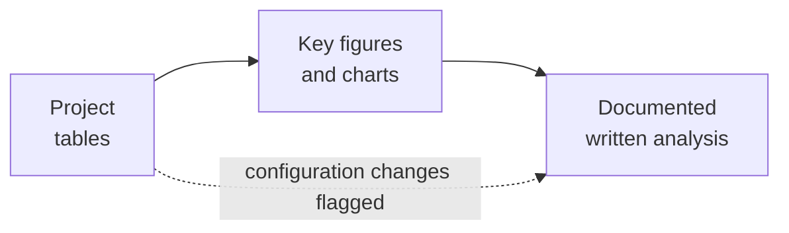
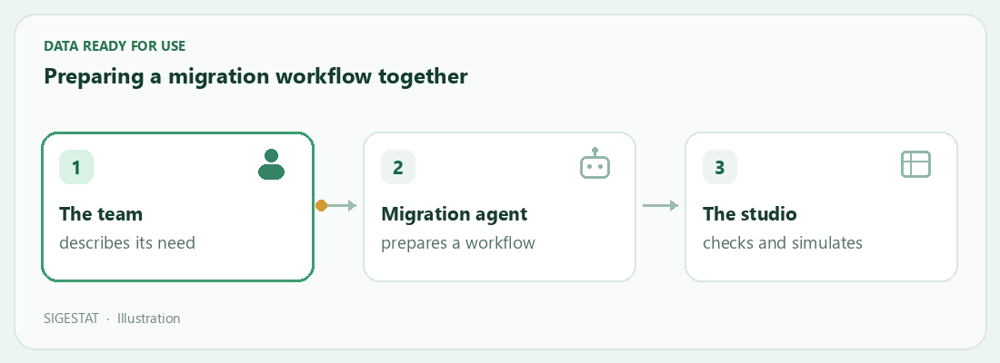

# SIGESTAT

[Français](README.md) · [English](README.en.md)

### From data to a statistical yearbook, in one workspace

SIGESTAT helps teams collect, organise and publish statistics. The platform supports data preparation, table creation and updates, and the assembly of a statistical yearbook. It also provides a migration studio and assistants to help with these steps.

This page introduces SIGESTAT’s core capabilities and its main improvements for people using or discovering the application. It is not a technical list of every code change.

[**Download SIGESTAT for Windows**](https://github.com/qfjkl/sigestat-launcher/releases/latest/download/SIGESTAT.exe) · [See available files](https://github.com/qfjkl/sigestat-launcher/releases/latest)

[What’s new](#whats-new) · [Tables and yearbooks](#produce-and-update-tables) · [Analysis and dashboards](#analyse-and-decide) · [Migration](#prepare-and-migrate-data) · [Teamwork](#work-together-and-keep-a-record) · [Agents](#sigestat-agents) · [Installation](#install-and-get-started)

> **Two different versions.** The Windows download is the *launcher*, currently version **1.2.1**. It starts the SIGESTAT application, whose version appears in its interface. Available capabilities also depend on your installation’s updates and configuration.

*The screenshots illustrate demonstration scenarios. The interface may differ depending on the version and installation settings.*

## For organisations and their partners

NGOs, associations, public agencies and project teams can use SIGESTAT to organise data, prepare reports and keep a record of their work. Teams define their own indicators and scope, allowing the platform to support education, health and other fields according to the data available.

For example, an organisation can prepare the same monitoring table for several regions and years, update the relevant tables when new data arrives, then accompany the results with an analysis and a publication. A project copy can be shared with another team, subject to permissions and available sources.

| Common need | What SIGESTAT supports |
|---|---|
| Produce consistent tables for several territories or periods | Generate variants from a reference table for selected combinations. |
| Update a recurring report | Refresh every table in a project or only a selected group. |
| Explain figures to partners or decision-makers | Prepare analyses with text, key figures, tables and charts. |
| Work together and follow changes | Manage accounts and projects, inspect history and retrieve versions. |
| Reuse work or prepare a new edition | Copy or transfer a project, its tables, analyses and settings. |

## What’s new

These improvements make it easier to produce, analyse and share data. Their availability depends on your installation’s updates and configuration.

- **Analysis and assistance**: an assistant supports teams, and analyses are accessible from projects. Conversations have also been improved.
- **Tables and publication**: table families and variants, Word exports, publication information, alignment and the display of statistical values have been improved. Data mapping is easier to navigate.
- **Migration and data**: the migration studio and its agent offer capabilities for workbooks and workflows. Retrying view requests has been improved.
- **Teamwork and security**: accounts and roles, first-account setup, administrator access recovery and checks on sensitive actions support access management.
- **Installation and transfer**: the launcher provides verified automatic updates. Project transfers retain more content and settings.

## Produce and update tables

### Organise data and projects

Teams can create projects, connect them to data sources and find their tables and work in one place. They can explore source structures, search for information and refresh metadata. Available connections depend on the installation and include SQL databases and Access sources.

Projects can be copied, imported or exported for reuse. Project variables help adapt tables to a context such as a reporting round, territory or subsector.

*Illustration of a collaboration workflow with the yearbook agent; proposed actions depend on permissions and the selected autonomy mode.*

### Design and update tables

The table builder lets teams define a layout, choose data and organise rows and columns. It supports groupings, totals, formulas, filters, sorting and mappings between labels and source data.

It can combine **multiple analysis dimensions** in one table—for example, student numbers by region, year and sex. Based on the configuration and mappings, SIGESTAT automatically compiles the SQL queries needed to retrieve and aggregate source data.

Teams can preview and style the result and export it, including to **Excel** or **Word**. A saved configuration can be reused and refreshed as data changes, without rebuilding the layout.

*Example mapping: table labels are linked to source values and data. The screenshot shows the French interface.*

### Create table variants for different needs

Starting from a **reference table**, a team can create a family of tables for selected years, regions, programmes or other values. The team chooses the combinations to generate, searches for those it needs and can adapt filters for individual variants.

This **saves time**: rather than recreating and formatting each table separately, the team reuses the model and generates the required variants.

For example, an enrolment table can be varied by year and territory, with the resulting family collected in the project. Inheritance options help update a family while preserving selected adaptations.

**A concrete example.** In the study of Cameroon’s education sector yearbook, 127 statistical tables are based on 31 distinct forms. This analysis illustrates how the same form can support multiple variants. [Explore the SIGESTAT case study](https://sigestat.com/case-cameroon.html).

*Demonstration: the team selects the year × region combinations to generate. The screenshot shows the French interface.*

### Refresh all tables or a selection

When source data changes, teams can **refresh all tables in a project** without opening them one by one. A targeted refresh can instead cover a family, selected tables, a year or chosen variable combinations.

Before launch, the interface shows the scope and number of affected tables. The team can follow progress and inspect results and difficulties. This supports a new reporting round while leaving control over what is recalculated.

### Present tables clearly

- **Reusable models**: reuse project and table settings when creating new work.
- **Presentation and readability**: customise styles, units, totals and row or column visibility. Headers and values remain aligned when sections have different categories.
- **Statistical values**: when enabled for the project, use configurable markers to distinguish a genuine zero from missing, unavailable, out-of-scope or non-computable data. Visual replacement of zeros preserves their numeric value in exports.
- **Publication information**: prepare source lines, publication variables and table references.

### Prepare a consistent publication

Tables can be assembled into a yearbook using a Word template. SIGESTAT helps prepare publication details and locate the tables to insert. Source information can be defined for a project or table family, then checked before applying it.

*The publication workspace helps prepare a source line and see how it applies to tables. The screenshot shows the French interface.*

## Analyse and decide

### Analyses and dashboards

**Written analyses** are saved in the project alongside tables. They bring together explanations, key figures, reference tables, charts and notes. The yearbook agent can propose a **dashboard in the form of an analysis**, combining indicators, charts and explanations relevant to a question. Depending on the selected autonomy mode, a person reviews the proposal before it is saved.

Charts are built from the tables cited in the analysis, so readers can trace the underlying figures and inspect details on hover in the application. The document retains the tables as they were when saved: its figures do not update automatically. SIGESTAT flags a cited table whose configuration has changed or which has disappeared; simply refreshing source data does not necessarily trigger that warning. Teams should therefore check dates and review analyses when data changes.

*Illustrative education example. The data is fictional and the layout illustrates the application’s possibilities.*

## Prepare and migrate data

### A studio for preparing and loading data

The **migration studio** provides a visual workspace to design a workflow: read a workbook or table, filter and transform data, then export or load it to a destination. Guided steps help establish mappings; uncertain suggestions remain available for review.

Validation, preview and simulation help teams check work before execution. The studio provides progress, problems and rejected records, as well as workflow history and versions.

*Illustration of preparing a workflow; the team checks the result before execution.*

*Example workflow with demonstration names and data. The screenshot shows the French interface.*

Project workbooks can be found, downloaded and shared according to available permissions. The editor can correct cells in a **new copy**, retaining the original. Before applying certain changes, SIGESTAT shows affected workflows and detected risks.

### Better visibility into views and sources

**SIGESTAT views** let teams reuse a data definition across several tables. A request can be reviewed before creation in the database; its query can be inspected and copied. If a request fails, the interface shows the available reason and allows it to be submitted again.

By default, the account configured for the source is used to save views; a dedicated account can also be specified. Required permissions are checked before execution.

## Work together and keep a record

### Find versions and history

Table configuration changes are available in the **version history**, including date, author, origin and change summary when available. An earlier configuration can be inspected and restored; a restoration that changes the configuration is itself recorded.

Analyses also have versions. In the migration studio, workflow history supports inspection of earlier versions and reuse as a starting point. Saved results and table configuration are distinct: retrieving an old configuration does not itself replace source data.

### Accounts, roles and organisations

SIGESTAT provides administration screens for **accounts**, **organisations**, **roles** and **authorisations**. An organisation can represent a structure or team; authorisations can be assigned over a suitable scope, such as an organisation or selected projects.

Available roles cover reading, table design and validation, source management, migration workflow design, loading and administration. Roles can also be adapted to installation needs. Administrators can enable or disable accounts, assign roles and issue a temporary code when a user needs to choose a new password.

An activity log helps trace recorded actions. Sign-in is required by default for business features. **Enforcement of permissions and scope is a separate setting**: it depends on installation configuration and must be enabled and checked by the administration team. What people and agents can actually access depends on that configuration.

The interface has also been improved for keyboard navigation, narrower screens, and switching between available themes and languages.

## SIGESTAT agents

### Assistants for everyday work

Two conversational agents support different tasks. Their capabilities depend on the configured model, accessible data and the permissions of the person using them.

**The yearbook agent** can:

- explore project sources and tables, answer questions and explain results;
- prepare or modify table, mapping, filter and style proposals;
- propose variants, analyses, dashboards or a SIGESTAT view request;
- inspect available analyses and versions to help explain existing work.

**The migration agent** can:

- explore accessible projects, sources, workbooks and workflows;
- prepare or modify a workflow, its components and mappings;
- create a workbook or reading template, propose cell corrections and sharing between projects;
- propose a preview or simulation, follow its outcome and help explain problems or rejected records.

Three autonomy settings control how work proceeds:

| Setting | How it works |
|---|---|
| **Plan** | Prepare proposals without applying them. |
| **Ask** | Review and accept or reject proposed actions. |
| **Automatic** | Apply actions authorised by the installation’s permissions and rules. |

Executing a database load remains a decision made in the studio. View proposals follow their own approval process. Conversations can be revisited; work progress and tool calls are available in collapsible sections. Available inputs and outputs, potentially limited by privacy rules, can be copied.

*The agent helps prepare a workflow and presents its proposals in the studio. The screenshot shows the French interface.*

See an example of tool-call details

Assistants require a model configured for the installation. The data they can access and actions they can propose depend on permissions and settings; review their proposals before use.

## Install and get started

1. On **Windows**, download [SIGESTAT.exe](https://github.com/qfjkl/sigestat-launcher/releases/latest/download/SIGESTAT.exe) from this repository.
2. Check that **Docker Desktop** is installed and available. An Internet connection is required at first startup to retrieve application components.
3. Run the file and follow the on-screen instructions. Once SIGESTAT is ready, open the application in your browser.
4. For a first installation without an account, use **Activate accounts** to set up the first administrator account. For an existing installation, sign in with your usual account.

The launcher checks for available updates. The application and launcher have separate versions; contact your installation’s administrator for help or to learn which options are enabled.

The [Releases page](https://github.com/qfjkl/sigestat-launcher/releases) also contains the client archive and files associated with each launcher version.
