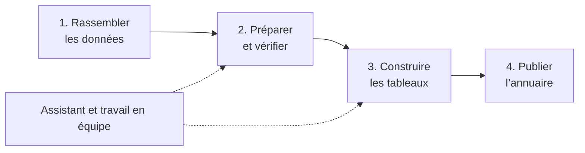

# SIGESTAT

### Des données à l’annuaire statistique, dans un même espace de travail

SIGESTAT accompagne les équipes qui collectent, organisent et publient des statistiques. La plateforme aide à préparer les données, construire des tableaux, les actualiser et les réunir dans un annuaire. Elle propose aussi un studio de migration et des assistants pour accompagner ces étapes.

Cette page présente les fonctions qui constituent le socle de SIGESTAT et les principales évolutions apportées jusqu’au **27 octobre 2026**. Elle s’adresse aux personnes qui utilisent ou découvrent l’application ; ce n’est pas une liste technique de tous les changements du code.

[**Télécharger SIGESTAT pour Windows**](https://github.com/qfjkl/sigestat-launcher/releases/latest/download/SIGESTAT.exe) · [Voir les fichiers disponibles](https://github.com/qfjkl/sigestat-launcher/releases/latest)

> **Deux versions à distinguer.** Le fichier téléchargé est le *lanceur* Windows, actuellement en version **1.2.1**. Il démarre l’application SIGESTAT, dont la version est affichée dans son interface. Les fonctionnalités accessibles dépendent aussi des mises à jour et de la configuration de votre installation.

*Les captures de cette page illustrent des scénarios de démonstration. La présentation peut évoluer selon la version et les réglages de l’installation.*

## Ce que SIGESTAT permet de faire

### Organiser ses données et ses projets

Une équipe peut créer des projets, les associer à des sources de données et y retrouver ses tableaux et ses travaux. L’application permet d’explorer les structures des sources, de rechercher des informations et d’actualiser leurs métadonnées. Les connexions disponibles dépendent de l’installation ; elles comprennent notamment des bases SQL et des sources Access.

Les projets peuvent être copiés, importés ou exportés pour réutiliser un travail. Les variables de projet aident à adapter les tableaux à un contexte, par exemple une campagne, un territoire ou un sous-secteur.

### Concevoir et actualiser des tableaux

Le concepteur de tableaux permet de définir une présentation, de choisir les données à utiliser et d’organiser les lignes et les colonnes. Il prend en charge les regroupements, les totaux, les formules, les filtres, les tris et les correspondances entre les libellés et les données.

On peut prévisualiser le résultat, ajuster son style et l’exporter, notamment vers **Excel** ou **Word**. Une configuration enregistrée peut être réutilisée et actualisée lorsque les données changent, sans recommencer la mise en forme.

*Exemple de mise en correspondance : les libellés du tableau sont reliés aux valeurs et aux données de la source.*

### Préparer une publication cohérente

Les tableaux peuvent être réunis dans un annuaire à partir d’une maquette Word. SIGESTAT aide à préparer les éléments de l’édition et à retrouver les tableaux à insérer. Les informations de source peuvent être définies pour un projet ou une famille de tableaux, puis vérifiées avant leur application.

*L’espace des mentions de publication permet de préparer la ligne Source et de voir comment elle s’applique aux tableaux.*

## Les principales évolutions

### Des tableaux plus faciles à décliner et à présenter

- **Familles et déclinaisons** : à partir d’un tableau de référence, préparer des variantes selon les valeurs retenues, par exemple plusieurs années ou plusieurs territoires. Les choix d’héritage permettent de conserver les adaptations nécessaires.
- **Modèles réutilisables** : retrouver des réglages de projet et de tableau pour gagner du temps lors de la création de nouveaux travaux.
- **Présentation et lisibilité** : personnaliser les styles, les unités, les totaux et la visibilité des lignes ou colonnes. Les en-têtes et les valeurs restent alignés lorsque des sections n’ont pas exactement les mêmes catégories.
- **Valeurs statistiques** : lorsque la fonction est activée pour le projet, distinguer un vrai zéro d’une donnée manquante, indisponible, hors champ ou non calculable, avec des marqueurs configurables. Le remplacement visuel des zéros conserve leur valeur numérique dans les exports.
- **Mentions et édition** : préparer les lignes Source, les variables d’édition et les références des tableaux dans les documents de publication.

### Un studio pour préparer et charger les données

Le **studio de migration** offre un espace visuel pour dessiner un traitement : lire un classeur ou une table, filtrer et transformer les données, puis les exporter ou les charger dans une destination. Des parcours guidés aident à établir les correspondances ; les propositions incertaines restent à examiner.

La vérification, l’aperçu et la simulation permettent de contrôler le travail avant l’exécution. Le studio donne accès à la progression, aux problèmes et aux rejets, ainsi qu’à l’historique et aux versions des traitements.

*Exemple de traitement : une lecture, un filtre et un export. Les noms et données affichés sont issus d’une recette de démonstration.*

Les classeurs utilisés dans les projets peuvent être retrouvés, téléchargés et partagés selon les droits disponibles. L’éditeur permet de corriger des cellules dans une **nouvelle copie**, en conservant le fichier d’origine. Avant d’appliquer certaines modifications, SIGESTAT présente les traitements concernés et les risques détectés.

### Des assistants pour accompagner le travail

L’assistant de l’annuaire aide à explorer les sources et les tableaux, à répondre aux questions et à préparer des propositions. Dans le studio, l’agent de migration peut notamment aider à préparer un traitement, proposer des correspondances, lancer une simulation et expliquer les résultats.

Trois réglages d’autonomie permettent de choisir la manière de travailler :

| Réglage | Fonctionnement |
|---|---|
| **Planifier** | Préparer des propositions sans les appliquer. |
| **Demander** | Examiner et accepter ou refuser les actions proposées. |
| **Automatique** | Appliquer les actions autorisées par les droits et les règles de l’installation. |

L’exécution d’un chargement dans une base reste une décision prise dans le studio. Les conversations peuvent être retrouvées ; le déroulement du travail et les appels d’outils sont consultables dans des sections repliables. Les entrées et sorties d’outils disponibles peuvent être copiées.

*L’agent accompagne la préparation du traitement et présente ses propositions dans le contexte du studio.*

Voir un exemple de détail d’appel d’outil

L’utilisation des assistants nécessite qu’un modèle soit configuré pour l’installation. Les données qu’ils peuvent consulter et les actions qu’ils peuvent proposer dépendent des droits et des réglages ; examinez leurs propositions avant de les utiliser.

### Des vues et des sources mieux suivies

Les **vues SIGESTAT** permettent de réutiliser une définition de données dans plusieurs tableaux. Une demande peut être examinée avant sa création dans la base ; la requête est consultable et peut être copiée. Si une demande échoue, l’interface indique la raison disponible et conserve la possibilité de la soumettre à nouveau.

Par défaut, le compte configuré pour la source est utilisé pour enregistrer les vues ; un compte dédié peut également être renseigné. Les droits nécessaires sont vérifiés avant l’exécution.

### Travail en équipe, accès et suivi

SIGESTAT propose des comptes, des organisations, des rôles et un suivi de l’activité. La connexion est demandée par défaut pour accéder aux fonctions métier. La prise en compte des rôles et les autorisations effectives dépendent de la configuration de l’installation.

Les écrans ont également évolué pour faciliter la navigation au clavier, l’utilisation sur des écrans plus étroits et le passage entre les thèmes et les langues disponibles.

## Installer et démarrer

1. Sur un poste **Windows**, téléchargez [SIGESTAT.exe](https://github.com/qfjkl/sigestat-launcher/releases/latest/download/SIGESTAT.exe) depuis ce dépôt.
2. Vérifiez que **Docker Desktop** est installé et disponible. Une connexion Internet est nécessaire au premier démarrage pour récupérer les composants de l’application.
3. Lancez le fichier et suivez les indications à l’écran. Une fois SIGESTAT prêt, ouvrez l’application dans votre navigateur.
4. Lors d’une première installation sans compte, utilisez **Activer les comptes** pour mettre en service le premier compte administrateur. Pour une installation déjà configurée, connectez-vous avec votre compte habituel.

Le lanceur vérifie les mises à jour disponibles. L’application et le lanceur ont chacun leur propre version ; renseignez-vous auprès de l’équipe qui administre votre installation en cas de difficulté ou pour connaître les options activées.

La page [Releases](https://github.com/qfjkl/sigestat-launcher/releases) contient également l’archive client et les fichiers associés à chaque version du lanceur.
