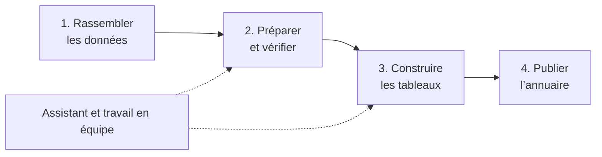
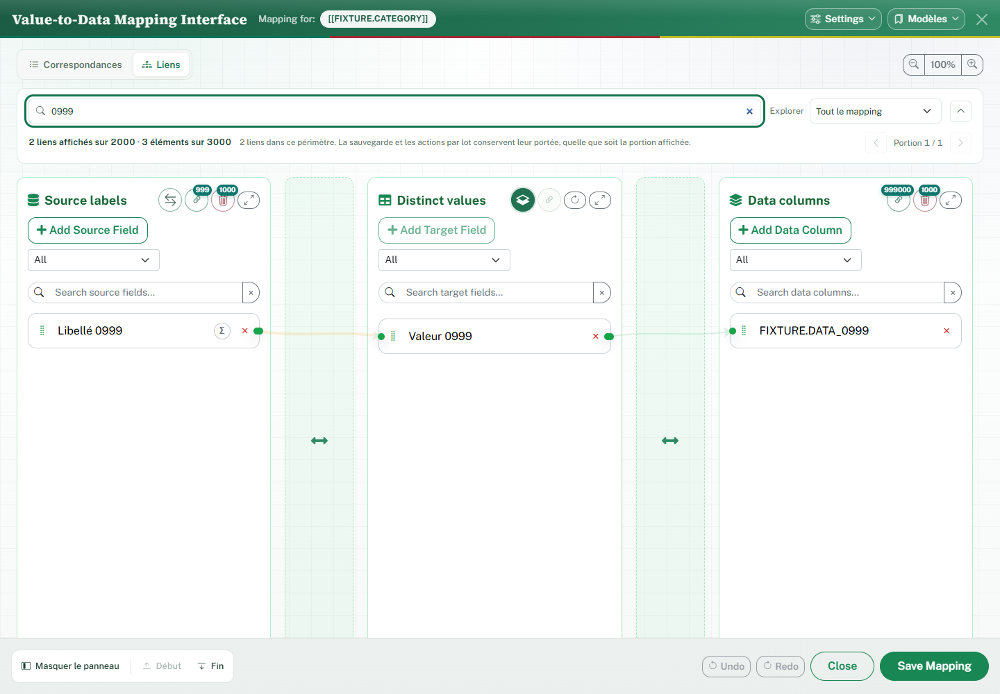
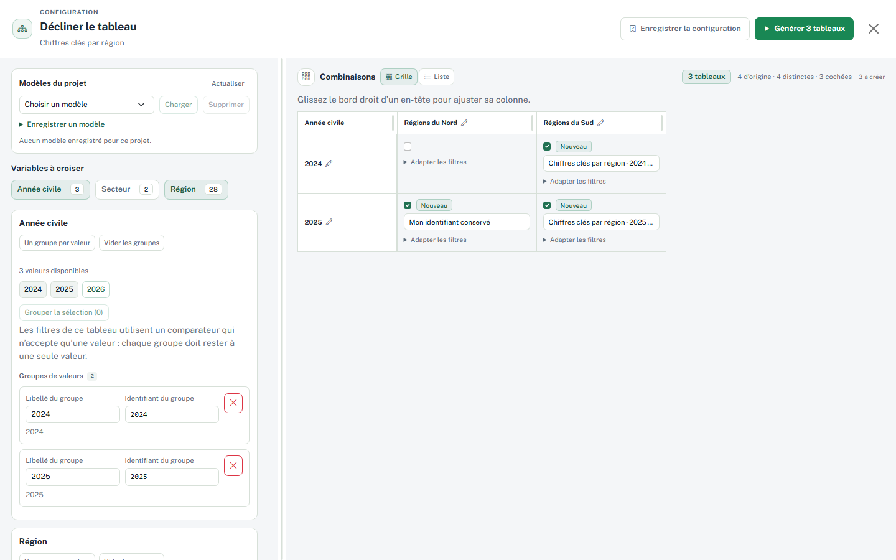
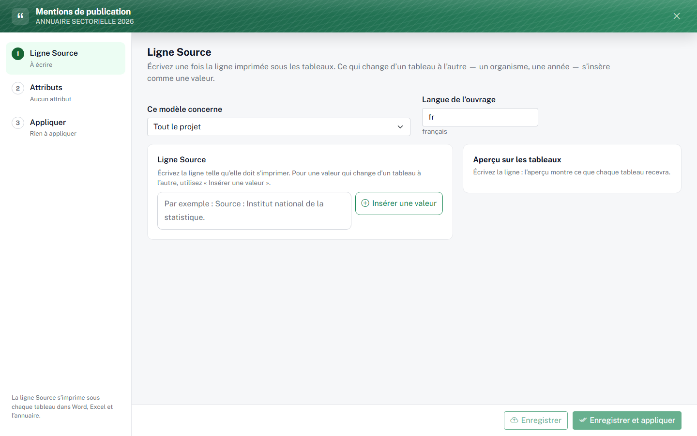
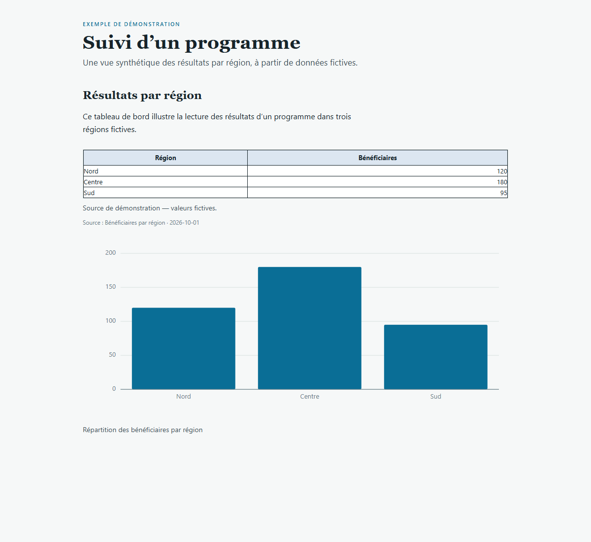
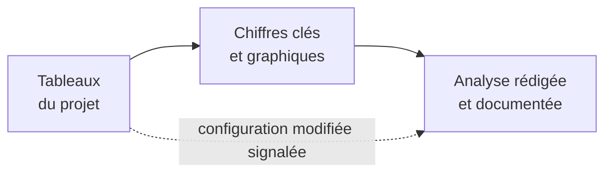
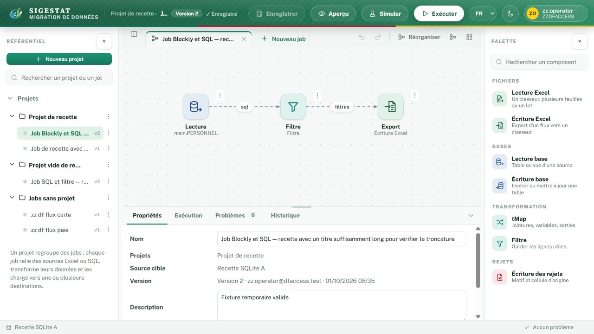
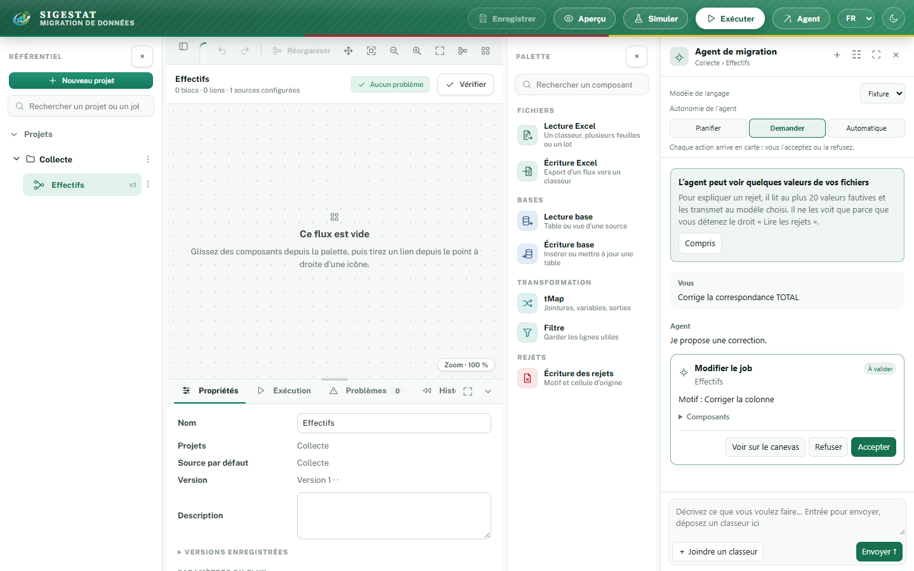
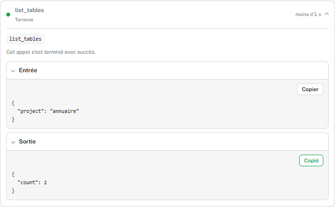

# SIGESTAT

### Des données à l’annuaire statistique, dans un même espace de travail

SIGESTAT accompagne les équipes qui collectent, organisent et publient des statistiques. La plateforme aide à préparer les données, construire des tableaux, les actualiser et les réunir dans un annuaire. Elle propose aussi un studio de migration et des assistants pour accompagner ces étapes.

Cette page présente les fonctions qui constituent le socle de SIGESTAT et ses principales évolutions. Elle s’adresse aux personnes qui utilisent ou découvrent l’application ; ce n’est pas une liste technique de tous les changements du code.

[**Télécharger SIGESTAT pour Windows**](https://github.com/qfjkl/sigestat-launcher/releases/latest/download/SIGESTAT.exe) · [Voir les fichiers disponibles](https://github.com/qfjkl/sigestat-launcher/releases/latest)

[Nouveautés](#nouveautés) · [Tableaux et annuaires](#produire-et-actualiser-des-tableaux) · [Analyses et tableaux de bord](#analyser-et-décider) · [Migration](#préparer-et-migrer-les-données) · [Travail en équipe](#travailler-en-équipe-et-garder-une-trace) · [Agents](#les-agents-sigestat) · [Installation](#installer-et-démarrer)

> **Deux versions à distinguer.** Le fichier téléchargé est le *lanceur* Windows, actuellement en version **1.2.1**. Il démarre l’application SIGESTAT, dont la version est affichée dans son interface. Les fonctionnalités accessibles dépendent aussi des mises à jour et de la configuration de votre installation.

*Les captures de cette page illustrent des scénarios de démonstration. La présentation peut évoluer selon la version et les réglages de l’installation.*

## Pour les organisations et leurs partenaires

ONG, associations, administrations et équipes de projet peuvent utiliser SIGESTAT pour organiser des données, préparer des rapports et conserver une trace du travail effectué. Les indicateurs et les périmètres sont définis par les équipes : l’outil peut ainsi servir dans l’éducation, la santé ou d’autres domaines, selon les données disponibles.

Par exemple, une organisation peut préparer un même tableau de suivi pour plusieurs régions et plusieurs années, actualiser les tableaux concernés à la réception de nouvelles données, puis accompagner les résultats d’une analyse et d’une publication. Elle peut partager une copie du projet avec une autre équipe, sous réserve de ses droits et des sources disponibles.

| Besoin courant | Ce que permet SIGESTAT |
|---|---|
| Produire des tableaux cohérents pour plusieurs territoires ou périodes | Décliner un tableau de référence selon les combinaisons choisies. |
| Mettre à jour un rapport périodique | Actualiser tous les tableaux d’un projet ou seulement un ensemble sélectionné. |
| Expliquer les chiffres à des partenaires ou à des décideurs | Préparer des analyses avec du texte, des chiffres clés, des tableaux et des graphiques. |
| Travailler à plusieurs et suivre les changements | Organiser les comptes et les projets, consulter l’historique et retrouver des versions. |
| Réutiliser un travail ou préparer une nouvelle édition | Copier ou transférer un projet, ses tableaux, ses analyses et ses réglages. |

## Nouveautés

Les évolutions ci-dessous facilitent la production, l’analyse et le partage des données. Leur disponibilité sur un poste dépend de sa mise à jour et de sa configuration.

- **Analyses et assistance** : un assistant accompagne les équipes et les analyses sont accessibles depuis les projets. Les conversations bénéficient également d’améliorations.
- **Tableaux et publication** : les familles de tableaux, les déclinaisons, les exports Word, les mentions de publication, l’alignement et l’affichage des valeurs statistiques ont été améliorés. La correspondance des données est plus facile à parcourir.
- **Migration et données** : le studio de migration et son agent proposent des fonctions pour les classeurs et les traitements. La reprise des demandes de vues a été améliorée.
- **Travail en équipe et sécurité** : les comptes et rôles, l’accès au premier compte, la récupération de l’accès administrateur et les contrôles des actions sensibles facilitent la gestion des accès.
- **Installation et transfert** : le lanceur dispose d’un mécanisme de mise à jour automatique vérifiée. Le transfert de projets conserve davantage de contenu et de réglages.

## Produire et actualiser des tableaux

### Organiser ses données et ses projets

Une équipe peut créer des projets, les associer à des sources de données et y retrouver ses tableaux et ses travaux. L’application permet d’explorer les structures des sources, de rechercher des informations et d’actualiser leurs métadonnées. Les connexions disponibles dépendent de l’installation ; elles comprennent notamment des bases SQL et des sources Access.

Les projets peuvent être copiés, importés ou exportés pour réutiliser un travail. Les variables de projet aident à adapter les tableaux à un contexte, par exemple une campagne, un territoire ou un sous-secteur.

### Concevoir et actualiser des tableaux

Le concepteur de tableaux permet de définir une présentation, de choisir les données à utiliser et d’organiser les lignes et les colonnes. Il prend en charge les regroupements, les totaux, les formules, les filtres, les tris et les correspondances entre les libellés et les données.

On peut prévisualiser le résultat, ajuster son style et l’exporter, notamment vers **Excel** ou **Word**. Une configuration enregistrée peut être réutilisée et actualisée lorsque les données changent, sans recommencer la mise en forme.

*Exemple de mise en correspondance : les libellés du tableau sont reliés aux valeurs et aux données de la source.*

### Décliner un tableau pour plusieurs besoins

Une équipe peut partir d’un **tableau de référence** et créer une famille de tableaux pour les années, régions, programmes ou autres valeurs qu’elle choisit. Elle sélectionne les combinaisons utiles avant de lancer la génération, recherche celles qui l’intéressent et peut adapter les filtres de certaines variantes.

Par exemple, un tableau conçu pour suivre les effectifs peut être décliné par année et par territoire, puis regroupé avec ses variantes dans le projet. Les choix d’héritage aident à mettre à jour une famille tout en conservant les adaptations voulues sur certains tableaux.

**Un cas concret.** Dans l’étude consacrée à l’annuaire sectoriel de l’éducation du Cameroun, 127 tableaux statistiques reposent sur 31 formes distinctes. Cette analyse illustre comment une même forme peut servir à plusieurs déclinaisons. [Découvrir l’étude de cas SIGESTAT](https://sigestat.com/case-cameroon.html).

*Exemple de démonstration : l’équipe choisit les croisements année × région qui donneront lieu à des tableaux.*

### Actualiser les tableaux en masse ou par sélection

Quand les données de la source évoluent, il est possible d’**actualiser l’ensemble des tableaux d’un projet**, sans les ouvrir un par un. Une actualisation ciblée permet aussi de choisir une famille, une sélection de tableaux, une année ou certaines combinaisons de variables.

Avant le lancement, l’interface présente le périmètre et le nombre de tableaux concernés. L’équipe peut suivre la progression et consulter les résultats et les difficultés rencontrées. Cela facilite la préparation d’une nouvelle campagne tout en laissant le choix de ce qui doit être recalculé.

### Des tableaux plus faciles à décliner et à présenter

- **Modèles réutilisables** : retrouver des réglages de projet et de tableau pour gagner du temps lors de la création de nouveaux travaux.
- **Présentation et lisibilité** : personnaliser les styles, les unités, les totaux et la visibilité des lignes ou colonnes. Les en-têtes et les valeurs restent alignés lorsque des sections n’ont pas exactement les mêmes catégories.
- **Valeurs statistiques** : lorsque la fonction est activée pour le projet, distinguer un vrai zéro d’une donnée manquante, indisponible, hors champ ou non calculable, avec des marqueurs configurables. Le remplacement visuel des zéros conserve leur valeur numérique dans les exports.
- **Mentions et édition** : préparer les lignes Source, les variables d’édition et les références des tableaux dans les documents de publication.

### Préparer une publication cohérente

Les tableaux peuvent être réunis dans un annuaire à partir d’une maquette Word. SIGESTAT aide à préparer les éléments de l’édition et à retrouver les tableaux à insérer. Les informations de source peuvent être définies pour un projet ou une famille de tableaux, puis vérifiées avant leur application.

*L’espace des mentions de publication permet de préparer la ligne Source et de voir comment elle s’applique aux tableaux.*

## Analyser et décider

### Analyses et tableaux de bord

Les **analyses rédigées** sont enregistrées dans le projet, à côté des tableaux. Elles permettent de rassembler une explication, des chiffres clés, des tableaux de référence, des graphiques et des notes dans un même document. L’agent de l’annuaire peut proposer un **tableau de bord sous forme d’analyse**, en réunissant les indicateurs, les graphiques et les explications utiles à une question. Une personne examine la proposition avant son enregistrement, selon le mode d’autonomie choisi.

Les graphiques sont construits à partir des tableaux cités dans l’analyse : le lecteur peut retrouver les chiffres qu’ils illustrent et consulter les détails au survol dans l’application. Le document conserve les tableaux tels qu’ils étaient lors de son enregistrement : ses chiffres ne se mettent pas automatiquement à jour. SIGESTAT signale si la configuration d’un tableau cité a changé ou si ce tableau a disparu ; une simple actualisation des données ne déclenche pas nécessairement cette alerte. L’équipe doit donc vérifier les dates et revoir l’analyse lorsque ses données évoluent.

*Rendu de démonstration produit par le moteur d’analyse SIGESTAT, avec des valeurs fictives.*

## Préparer et migrer les données

### Un studio pour préparer et charger les données

Le **studio de migration** offre un espace visuel pour dessiner un traitement : lire un classeur ou une table, filtrer et transformer les données, puis les exporter ou les charger dans une destination. Des parcours guidés aident à établir les correspondances ; les propositions incertaines restent à examiner.

La vérification, l’aperçu et la simulation permettent de contrôler le travail avant l’exécution. Le studio donne accès à la progression, aux problèmes et aux rejets, ainsi qu’à l’historique et aux versions des traitements.

*Exemple de traitement : une lecture, un filtre et un export. Les noms et données affichés sont issus d’une recette de démonstration.*

Les classeurs utilisés dans les projets peuvent être retrouvés, téléchargés et partagés selon les droits disponibles. L’éditeur permet de corriger des cellules dans une **nouvelle copie**, en conservant le fichier d’origine. Avant d’appliquer certaines modifications, SIGESTAT présente les traitements concernés et les risques détectés.

### Des vues et des sources mieux suivies

Les **vues SIGESTAT** permettent de réutiliser une définition de données dans plusieurs tableaux. Une demande peut être examinée avant sa création dans la base ; la requête est consultable et peut être copiée. Si une demande échoue, l’interface indique la raison disponible et conserve la possibilité de la soumettre à nouveau.

Par défaut, le compte configuré pour la source est utilisé pour enregistrer les vues ; un compte dédié peut également être renseigné. Les droits nécessaires sont vérifiés avant l’exécution.

## Travailler en équipe et garder une trace

### Retrouver les versions et l’historique

Les modifications de configuration d’un tableau peuvent être retrouvées dans son **historique des versions** : date, auteur, origine et résumé des changements lorsqu’ils sont disponibles. Une configuration précédente peut être consultée et restaurée ; la restauration est elle-même conservée dans l’historique lorsqu’elle modifie la configuration.

Les analyses possèdent également leurs versions. Dans le studio de migration, l’historique permet de consulter les versions d’un traitement et de reprendre une version comme point de départ. Les résultats déjà enregistrés et la configuration d’un tableau sont deux éléments distincts : retrouver une ancienne configuration ne remplace pas à elle seule les données de la source.

### Comptes, rôles et organisations

SIGESTAT propose des écrans d’administration pour gérer les **comptes**, les **organisations**, les **rôles** et les **habilitations**. Une organisation peut représenter une structure ou une équipe ; les habilitations peuvent être attribuées sur un périmètre approprié, par exemple une organisation ou certains projets.

Les rôles proposés couvrent notamment la lecture, la conception et la validation des tableaux, la gestion des sources, la conception des flux de migration, le chargement et l’administration. Des rôles peuvent aussi être adaptés aux besoins de l’installation. Les administrateurs disposent d’outils pour activer ou désactiver un compte, attribuer des rôles et émettre un code provisoire lorsqu’un utilisateur doit choisir un nouveau mot de passe.

Un journal d’activité aide à retrouver les actions enregistrées. La connexion est demandée par défaut pour les fonctions métier. **L’application effective des permissions et des périmètres est un réglage distinct** : elle dépend de la configuration de l’installation et doit être activée et vérifiée par l’équipe administratrice. Les possibilités réellement accessibles à chaque personne et aux agents en dépendent.

Les écrans ont également évolué pour faciliter la navigation au clavier, l’utilisation sur des écrans plus étroits et le passage entre les thèmes et les langues disponibles.

## Les agents SIGESTAT

### Des assistants pour accompagner le travail

Les deux agents accompagnent des tâches différentes à partir d’une conversation. Leurs capacités dépendent du modèle configuré, des données accessibles et des droits de la personne qui les utilise.

**L’agent de l’annuaire** peut notamment :

- explorer les sources et les tableaux du projet, répondre à des questions et expliquer des résultats ;
- préparer ou modifier des propositions de tableaux, de correspondances, de filtres et de styles ;
- proposer des déclinaisons, des analyses et des tableaux de bord, ou une demande de vue SIGESTAT ;
- consulter les analyses et les versions disponibles pour aider à comprendre un travail existant.

**L’agent de migration** peut notamment :

- explorer les projets, les sources, les classeurs et les traitements accessibles ;
- préparer ou modifier un traitement, ses composants et ses correspondances ;
- créer un classeur ou un modèle de lecture, proposer des corrections de cellules et un partage entre projets ;
- proposer un aperçu ou une simulation, suivre son résultat et aider à comprendre les problèmes ou les rejets.

Trois réglages d’autonomie permettent de choisir la manière de travailler :

| Réglage | Fonctionnement |
|---|---|
| **Planifier** | Préparer des propositions sans les appliquer. |
| **Demander** | Examiner et accepter ou refuser les actions proposées. |
| **Automatique** | Appliquer les actions autorisées par les droits et les règles de l’installation. |

L’exécution d’un chargement dans une base reste une décision prise dans le studio. Une proposition de vue suit également son propre circuit d’approbation. Les conversations peuvent être retrouvées ; le déroulement du travail et les appels d’outils sont consultables dans des sections repliables. Les entrées et sorties disponibles, éventuellement limitées par les règles de confidentialité, peuvent être copiées.

*L’agent accompagne la préparation du traitement et présente ses propositions dans le contexte du studio.*

Voir un exemple de détail d’appel d’outil

L’utilisation des assistants nécessite qu’un modèle soit configuré pour l’installation. Les données qu’ils peuvent consulter et les actions qu’ils peuvent proposer dépendent des droits et des réglages ; examinez leurs propositions avant de les utiliser.

## Installer et démarrer

1. Sur un poste **Windows**, téléchargez [SIGESTAT.exe](https://github.com/qfjkl/sigestat-launcher/releases/latest/download/SIGESTAT.exe) depuis ce dépôt.
2. Vérifiez que **Docker Desktop** est installé et disponible. Une connexion Internet est nécessaire au premier démarrage pour récupérer les composants de l’application.
3. Lancez le fichier et suivez les indications à l’écran. Une fois SIGESTAT prêt, ouvrez l’application dans votre navigateur.
4. Lors d’une première installation sans compte, utilisez **Activer les comptes** pour mettre en service le premier compte administrateur. Pour une installation déjà configurée, connectez-vous avec votre compte habituel.

Le lanceur vérifie les mises à jour disponibles. L’application et le lanceur ont chacun leur propre version ; renseignez-vous auprès de l’équipe qui administre votre installation en cas de difficulté ou pour connaître les options activées.

La page [Releases](https://github.com/qfjkl/sigestat-launcher/releases) contient également l’archive client et les fichiers associés à chaque version du lanceur.
